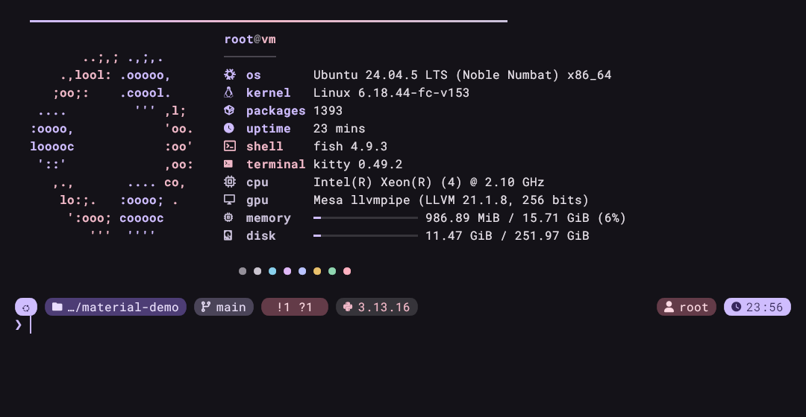
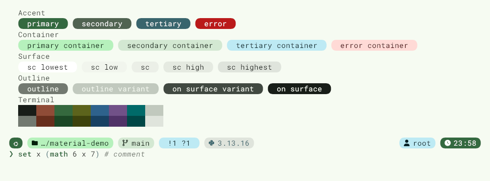
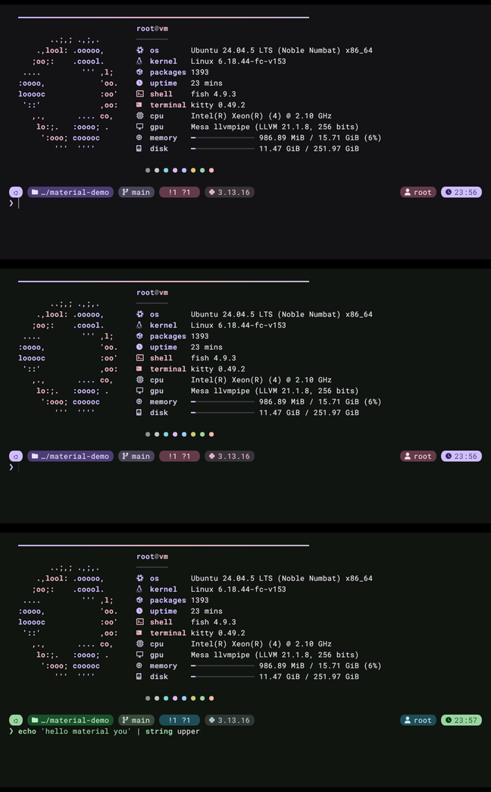

# Material You Terminal

Material You (Material Design 3) для терминала: **kitty**, **fish**, **starship** и **fastfetch**
в одной палитре, сгенерированной из цвета или обоев. Плавные анимации и живая перекраска
уже открытых окон. Подключается к NixOS через flake.

*Material You theming for kitty, fish, starship and fastfetch, generated from your wallpaper,
with smooth animations. Ships as a Nix flake (home-manager and NixOS modules).*





## Что внутри

| | |
|---|---|
| **Палитра** | Генерируется [matugen](https://github.com/InioX/matugen) по алгоритму Material You (HCT): `primary`, `secondary`, `tertiary`, контейнеры, поверхности, outline. 16 ANSI-цветов (red, green, …) гармонизируются с исходным цветом, поэтому `git diff` и `ls` вписываются в схему. |
| **kitty** | Цвета ролей M3, закруглённые вкладки-«пилюли», отступы, лёгкая прозрачность и блюр, увеличенная высота строки, курсор-«beam» со **следом (cursor trail)**, плавное мигание с easing, тонкий скроллбар, приглушение неактивных сплитов. |
| **fish** | Подсветка синтаксиса и пейджер автодополнения в цветах схемы, приветствие с анимацией. |
| **starship** | Промпт из Material-«чипов»: ОС, папка, git, nix-shell, языки, время выполнения, код ошибки, время. **Transient prompt**: старые промпты сворачиваются в `❯`. |
| **fastfetch** | Компактная карточка с иконками, сгруппированными по цветам (система, окружение, железо), и полосками в цвет `primary`. |
| **Анимации** | Волна-«ripple» при открытии терминала, каскадное появление fastfetch, **плавный морфинг цветов** во всех открытых окнах kitty при смене палитры (интерполяция в OKLab, кривая Material 3 *standard easing*). |

Пример морфинга (кадры через ~200 мс и ~380 мс, затем результат): тема перетекает из
фиолетовой в зелёную после `myt apply forest.png`, промпт подхватывает новые цвета без
перезапуска шелла.



## Установка

### 1. Добавить вход во flake

```nix
# flake.nix
{
  inputs = {
    nixpkgs.url = "github:NixOS/nixpkgs/nixos-unstable";
    home-manager.url = "github:nix-community/home-manager";
    home-manager.inputs.nixpkgs.follows = "nixpkgs";

    material-you-terminal.url = "github:kostr2007/Fish-starship-Material-You-addon";
    material-you-terminal.inputs.nixpkgs.follows = "nixpkgs";
  };
}
```

### 2a. NixOS + home-manager как модуль NixOS

```nix
outputs = { nixpkgs, home-manager, material-you-terminal, ... }: {
  nixosConfigurations.my-pc = nixpkgs.lib.nixosSystem {
    system = "x86_64-linux";
    modules = [
      ./configuration.nix
      home-manager.nixosModules.home-manager
      material-you-terminal.nixosModules.default   # подключает HM-модуль всем пользователям

      ({ pkgs, ... }: {
        programs.material-you-terminal.enable = true;  # fish в системе + шрифт
        users.users.kostr.shell = pkgs.fish;

        home-manager.users.kostr = {
          programs.material-you-terminal = {
            enable = true;
            source.image = ./wallpapers/current.jpg;  # или source.color = "#6750A4";
          };
        };
      })
    ];
  };
};
```

### 2b. Только home-manager (standalone)

```nix
homeConfigurations.kostr = home-manager.lib.homeManagerConfiguration {
  pkgs = nixpkgs.legacyPackages.x86_64-linux;
  modules = [
    material-you-terminal.homeManagerModules.default
    { programs.material-you-terminal.enable = true; }
  ];
};
```

После `nixos-rebuild switch` / `home-manager switch` **один раз перезапустите kitty**: сокет
для живой перекраски открывается только при старте. Дальше открытые окна будут плавно
перетекать в новую палитру после каждого switch.

## Настройки

```nix
programs.material-you-terminal = {
  enable = true;

  # Откуда брать цвет: сид-цвет или обои (обои копируются в store и
  # анализируются во время сборки).
  source.color = "#6750A4";
  source.image = ./wallpaper.png;

  mode = "dark";                   # "dark" | "light"
  scheme = "scheme-tonal-spot";    # expressive, vibrant, fidelity, content, rainbow, fruit-salad, neutral, monochrome
  contrast = 0.0;                  # от -1 до 1

  # Точечно переопределить роли или ANSI-цвета
  palette = { primary = "#D0BCFF"; ansi4 = "#82AAFF"; };
  # Базовые оттенки для ANSI (гармонизируются с сидом)
  customColors = { red = "#FF5555"; };

  font = { name = "RobotoMono Nerd Font"; size = 12; };  # package = pkgs.nerd-fonts.jetbrains-mono;

  animations.enable = true;        # trail, easing, ripple, морфинг
  animations.transitionMs = 450;

  kitty = { opacity = 0.94; blur = 32; padding = "10 14"; lineHeight = "108%"; };
  fish.greeting = "both";          # "both" | "fastfetch" | "ripple" | "none"
  starship.transientPrompt = true;
  starship.settings = { time.disabled = true; };          # мержится с встроенным конфигом
  fastfetch.logo = "nixos";                                # большой логотип вместо small
  fastfetch.settings = { display.key.width = 14; };
};
```

Ваши собственные `programs.kitty.settings`, `programs.fish.functions.fish_greeting` и т.п.
имеют приоритет над значениями аддона (всё задано через `mkDefault`).

Сгенерированная палитра доступна остальной конфигурации, например для Hyprland:

```nix
let c = config.programs.material-you-terminal.colors; in {
  wayland.windowManager.hyprland.settings.general."col.active_border" =
    "rgb(${lib.removePrefix "#" c.primary})";
}
```

В starship можно использовать имена ролей как цвета (`fg:primary`, `bg:tertiary_container`),
в `fastfetch.settings` — плейсхолдеры вида `"{{primary}}"`.

## Динамический режим: тема из текущих обоев

```nix
programs.material-you-terminal.dynamic = {
  enable = true;
  # Файл/симлинк, за которым следит systemd: при его изменении тема пересчитывается сама
  wallpaper = "~/.cache/current-wallpaper";
  # Команды после каждой смены темы
  hooks = [ "notify-send 'Material You' 'Терминал перекрашен'" ];
};
```

Тема, заданная в Nix, остаётся запасной. Команды:

```sh
myt apply ~/Pictures/forest.jpg   # новая палитра из обоев: kitty плавно перетекает, fish/starship подхватывают
myt apply '#3F6FD8'               # из цвета
myt apply colors.json             # из JSON, который уже генерирует ваш matugen
myt apply --scheme scheme-expressive
myt mode toggle                   # dark ⇄ light
myt refresh --reset               # вернуться к теме из Nix
myt palette                       # показать палитру
myt status
```

Если обои ставит скрипт (swww, hyprpaper, waypaper…), достаточно добавить в него
`myt apply "$WALLPAPER"` или обновлять симлинк из `dynamic.wallpaper`. Если цвета рабочего
стола у вас уже генерирует matugen, вызовите `myt apply` с теми же обоями в том же скрипте:
алгоритм и схема одинаковые, поэтому терминал совпадёт с остальным интерфейсом. `myt apply`
также принимает JSON, который выдаёт `matugen ... --json hex`.

## Как это устроено

```
source (цвет / обои) ─► matugen ─► палитра (роли M3 + ANSI) ─► шаблоны ─► kitty.conf
                                                                         colors.fish
                                                                         starship.toml
                                                                         fastfetch.jsonc
```

* `cli/myt.py`: утилита `myt` (только стандартная библиотека Python). Генерирует палитру,
  рендерит шаблоны, морфит цвета kitty через remote-control сокет (`socket-only`, в
  `$XDG_RUNTIME_DIR`, доступен только вашему пользователю).
* `templates/`: шаблоны с плейсхолдерами `{{role}}`, `{{role.strip}}`, `{{role.rgb}}`.
* `modules/starship.nix`, `modules/fastfetch.nix`: конфиги как Nix-атрибуты, поэтому их
  можно мержить со своими.
* В статическом режиме тема собирается целиком на этапе `nix build` (воспроизводимо, без
  сети). В динамическом она лежит в `~/.local/state/material-you-terminal/theme`.

Отключить анимации в одной сессии: `set -gx MYT_NO_ANIMATION 1`, приветствие: `MYT_NO_GREETING`.

## Разработка

```sh
nix build .#theme-preview        # отрендерить тему по умолчанию в ./result
nix flake check                  # шаблоны проверяются настоящими fish, starship, fastfetch и kitty
nix develop                      # python, matugen, kitty, fish, starship, fastfetch
```

## Лицензия

MIT
